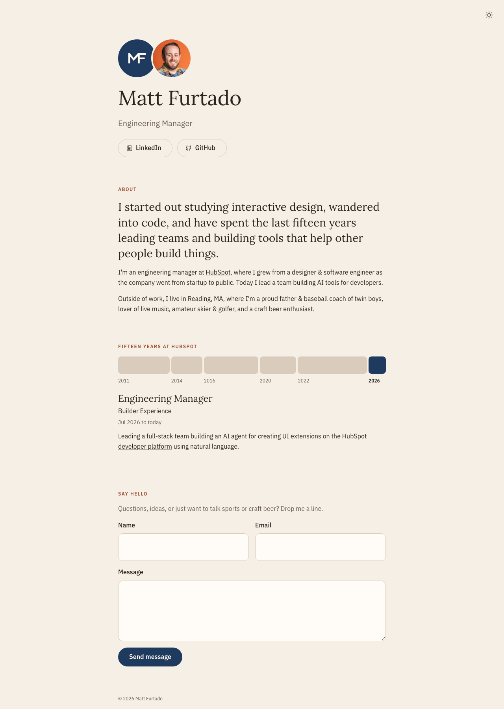

# mattfurtado.com

Personal site for Matt Furtado, live at [www.mattfurtado.com](https://www.mattfurtado.com).



## Stack

- **[Lit](https://lit.dev)** web components, written in TypeScript
- **[Vite](https://vite.dev)** for the dev server and production build
- **[Vercel](https://vercel.com)** for hosting, deploying from `main`, plus a serverless function for the contact form
- **[Resend](https://resend.com)** for contact form email, installed through the Vercel Marketplace
- **Google Sheets API** for keeping a log of contact form messages
- **Google Analytics 4** for page views, clicks, and form submissions
- **pnpm** for package management

The site is a single static page. Lit is the only library it ships to the browser, and all of its JavaScript comes to about 11 KB gzipped.

## Getting started

```sh
pnpm install
pnpm dev       # start the dev server (site only)
vercel dev     # start the site and the contact form function
pnpm build     # type-check the site and function, then build to dist/
pnpm preview   # serve the production build
```

Environment variables live in Vercel. Run `vercel env pull` to copy them into `.env.local` for local development.

## Project layout

```
index.html              Page shell, fonts, and social sharing tags
vite.config.ts          Fills in the site URL for absolute links in index.html
api/
  contact.ts            Contact form function: sends the email and logs a row in Google Sheets
public/                 Favicon and share image, copied as-is
src/
  main.ts               Entry point that loads the page, theme toggle, and consent banner
  content.ts            All site copy and career data
  mf-home.ts            Page layout: header, About, timeline, contact
  mf-timeline.ts        Interactive career timeline
  mf-contact-form.ts    Contact form with sending, sent, and error states
  mf-logo.ts            MF monogram as an inline SVG
  analytics.ts          Google Analytics setup, consent, click tracking, and a track() helper
  mf-consent-banner.ts  Cookie consent banner
  mf-theme-toggle.ts    Light and dark mode toggle
  styles.css            Global color and font tokens
  shared-styles.ts      Link, focus, and heading styles shared by components
  assets/               Images processed by Vite
```

## How it works

**Content is separate from components.** Text, links, and roles live in `src/content.ts`. Most entries are plain strings; entries that need inline links are Lit `html` templates.

**Styling uses CSS custom properties.** Colors and fonts are defined once on `:root` in `src/styles.css`. Those values inherit into each component's shadow DOM, so changing a token updates the whole site. Type is Lora for headings and IBM Plex Sans for body copy. Font sizes and spacing use multiples of 4px, with 14px timeline dates as the one exception.

**Dark mode** uses the same tokens with darker values, defined in `src/styles.css`. The site follows the visitor's system setting until they use the toggle in the top right, which saves their choice to `localStorage`. A small script in `index.html` applies a saved choice before the page draws, so it never flashes the wrong theme.

**The timeline** is a CSS grid with one column per role. Each column is `minmax(44px, <months>fr)`, so widths reflect tenure but never drop below a usable tap target. Each column is a button labeled with the role's start year. Selecting one shows the role's details below the grid, and the left and right arrow keys move between roles.

**Social sharing tags** (Open Graph and Twitter) in `index.html` use a `%SITE_URL%` placeholder. A small plugin in `vite.config.ts` replaces it with `https://www.mattfurtado.com` at build time, because link previews require absolute URLs. The share image is `public/og-image.png` (1200×630).

**The contact form** posts JSON to `/api/contact`, a Vercel function. The function checks the fields, then does two things in parallel: emails the message through Resend, with the visitor as the reply-to, and appends a row to a Google Sheet through a service account. The visitor sees success if either one works, and any failure is logged in Vercel. A hidden honeypot field filters out simple bots, and each submission carries an id that Resend uses as an idempotency key, so a retry never sends twice.

| Variable | Purpose |
|---|---|
| `RESEND_API_KEY`, `RESEND_EMAIL_DOMAIN` | Resend key and sending domain, added by the Marketplace integration |
| `CONTACT_TO_EMAIL` | Where contact form messages are sent |
| `GOOGLE_SERVICE_ACCOUNT_EMAIL`, `GOOGLE_PRIVATE_KEY` | Service account with edit access to the sheet |
| `GOOGLE_SHEET_ID` | The sheet that logs messages (rows go to its first tab) |
| `VITE_GA_MEASUREMENT_ID` | GA4 measurement ID, set for production only |

**Analytics** loads Google Analytics only in production builds with `VITE_GA_MEASUREMENT_ID` set, so local development and preview deploys send nothing. GA's automatic outbound link tracking can't see inside shadow DOM, so `src/analytics.ts` listens for clicks on the document and reads each event's composed path to find the link or button and its section.

| Event | Sent when | Parameters |
|---|---|---|
| `page_view` | The page loads (sent by GA) | Standard GA fields |
| `element_click` | Any link or button is clicked | `element_type`, `element_text`, `section`, and for links `link_url` and `outbound` |
| `contact_form_submit` | The contact form is submitted | None |
| `generate_lead` | A message is sent successfully | `form` |
| `contact_form_error` | Sending fails | `reason` (`network`, `invalid`, or `server`), `http_status` |

Form contents are never sent to Google Analytics.

**Consent** uses Google Consent Mode v2. Ad features are denied everywhere. Analytics cookies default to denied in the EEA, the UK, and Switzerland and to granted elsewhere; Google applies the right default from the visitor's location. Every visitor sees a banner with equally weighted Accept and Decline buttons, and the choice is saved in `localStorage` and applied on later visits. "Cookie settings" in the footer reopens the banner. To try the banner locally, where analytics is off, add `?consent` to the URL (for example `http://localhost:5173/?consent`).
